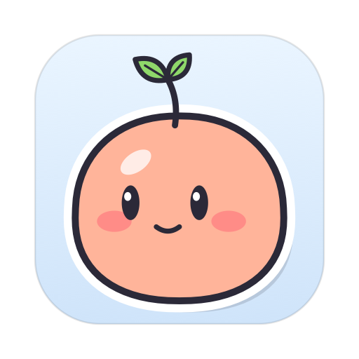
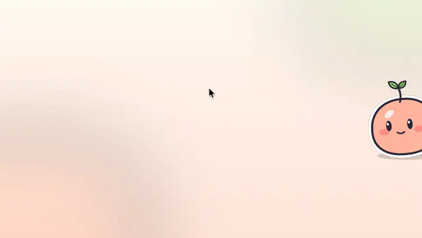
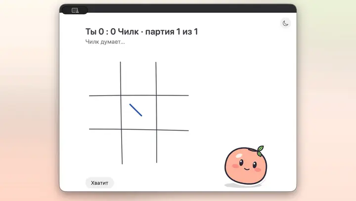

<p align="center">
  
</p>

<h1 align="center">Chilk</h1>

<p align="center">
  <b>A little living companion at the edge of your Mac's screen<br>
  who makes sure you drink water, stretch, take walks and stop working on time.</b>
</p>

<p align="center">
  <a href="https://github.com/all0b0y/Chilk/releases/latest"></a>
  
  
  <a href="LICENSE"></a>
</p>

<p align="center"><b>English</b> · <a href="docs/i18n/README.ru.md">Русский</a></p>

<!-- HERO_VIDEO_EN -->

> [!NOTE]
> **Chilk speaks Russian only for now.** His bubbles, his ears and his answers are in Russian; an English version is
> planned. The videos have English captions.

## Why

Reminder timers get ignored, then switched off. Chilk is not a timer — he is a character. He lives at the edge of your
screen, breathes, blinks and follows your cursor with his eyes. When you have been sitting for too long, he cares: first
a hint, then a request, and in Strict mode he really interrupts your work. He stays a friend, not a warden: you can
talk him out of it, there is always an emergency exit, and calls are off-limits.

## What he does

### Alive



- Breathes, blinks, watches your cursor and gets up to little things on his own — yawns, plays with his leaf, catches a
  speck of dust.
- Click him and he is offended; three clicks make him dizzy; stroke him with the cursor and he winks.
- Drag him to any edge and height, or tuck him behind the edge — he still peeks out now and then. With several
  monitors he leaps over to the one you work on.
- The leaf on his head shows how tired you are. He laughs at your jokes, sulks and clowns around, and dances when music
  plays.

### Care that insists


- Water, stretching, eye breaks, walks, the end of the workday and bedtime — not on a rigid timer but by accumulated
  need, at a good moment: when you switch apps or pause typing. Calls, screen sharing and full-screen apps are left
  alone.
- Ignore him and he insists more: a pantomime, a bubble, a stronger request, and in Strict mode a full-screen pause.
  Water and eye breaks never lock you out. Ignore everything for long enough and he lies down and asks for help.
- An emergency exit with a reason is always there (limited, never impossible). You can talk him into a delay by
  explaining why now matters, and declare «do not disturb» in advance; postponed rest adds up as a debt.
- Three modes — Strict, Soft and Silence — and you cannot soften the mode in the middle of an escalation.
- Breaks with him: breathe together (he inflates and deflates), do eye exercises following him in flight, take a walk —
  he puts on his hat, packs his backpack, leaves with you and is glad when you are back.

### Voice and your Apple apps


- Say «Чилк, …» or press <kbd>⌃⌥Space</kbd>: he flies out from the edge and listens, and you see your words as you
  speak.
- His brain is [Codex](https://github.com/openai/codex) under your ChatGPT account. He answers in a bubble (long answers
  open in a panel), searches the web, finds things in the folders you allow (read-only), and puts things into your Apple
  apps: reminders, calendar events, notes and Clock timers.
- Anything he writes waits for your «Да» on a card, and only into his own «Чилк» list, calendar and Notes folder.
- Plan your day in one conversation and confirm it with one card. A day sheet with checkmarks, a morning summary, an
  evening review, and what is left moves to tomorrow.
- He remembers facts about you — you can see, edit and delete every one of them.

### Games



Tic-tac-toe, basketball, sea battle and Russian draughts — with Chilk, right on your desktop.

<sub>The videos were recorded on a demo profile with test reminders, events and notes; the answers are real Codex
answers.</sub>

## Install

Open **Terminal** (Applications → Utilities), paste this line and press Return:

```sh
curl -fsSL https://raw.githubusercontent.com/all0b0y/Chilk/main/install.sh | bash
```

It downloads the latest release from GitHub, checks the DMG against `SHA256SUMS.txt` and Chilk's signature against his
certificate, puts Chilk into Applications (an older Chilk is asked to quit first; your data stays) and opens him. Run it
again to update. Chilk is not notarized by Apple — that needs a paid Apple developer account — but files downloaded by
Terminal are not marked as downloaded from the internet, so macOS doesn't stop him. The [script](install.sh) is short:
read it first if you like.

<details>
<summary><b>Or install from the DMG</b></summary>

1. Download **Chilk-0.1.0.dmg** from the [latest release](https://github.com/all0b0y/Chilk/releases/latest), open it
   and drag Chilk to the Applications folder. Its SHA-256 is in `SHA256SUMS.txt` next to it.
2. Open Chilk. The first time, macOS says “Apple could not verify “Chilk” is free of malware…”. Click **Done**, not
   **Move to Trash**: nothing is wrong with Chilk, he just isn't notarized.
3. Open **System Settings → Privacy & Security**, scroll down to **Security** and click **Open Anyway** next to
   “Chilk” was blocked to protect your Mac. Confirm with Touch ID or your password and click **Open Anyway** once more.
   macOS asks this once for each downloaded version.

</details>

Then:

1. Chilk appears at the edge of the screen; his remote control is the leaf in the menu bar (there is no Dock icon).
2. Give him a brain: install Codex — `brew install --cask codex` (or `npm install -g @openai/codex`) — then click the
   leaf in the menu bar → **Войти в Codex** and sign in with your ChatGPT account.
3. Allow what you use when he first asks: the microphone and speech recognition for voice, Reminders, Calendar and Notes
   for those apps. For Clock timers he offers to add his «Чилк» shortcut to Shortcuts — click **Add**. Turning his ears
   on downloads the wake-word model once (about 1.5 GB).

## Requirements

- macOS 26 or later on a Mac with Apple silicon.
- [Codex](https://github.com/openai/codex) and a ChatGPT account with Codex access — Chilk runs it in his own isolated
  profile, separate from yours.
- Russian: Chilk talks and listens in Russian.
- About 1.5 GB of disk space for the wake-word model, downloaded when you turn his ears on.

## Privacy

- What you do stays on your Mac: needs, breaks, your plan, your chats and the facts he remembers.
- He hears his name on your Mac (Whisper via Core ML), and your words are recognized by Apple's on-device dictation.
  Audio is not saved.
- What you ask him goes to OpenAI through Codex under your ChatGPT account. Codex runs in Chilk's own profile with no
  shell access and reads only the folders you chose.
- In Reminders, Calendar and Notes he touches only his own «Чилк» list, calendar and folder, and he writes only after
  your «Да».
- No analytics, no telemetry. Network traffic is Codex and the one-time model downloads.

## How it works

```
┌──────────────────────── Chilk.app ────────────────────────┐
│  ChilkCore    his body, needs, escalation ladder, planner │
│  ChilkRender  the character, drawn with Core Animation    │
│  ChilkEars    mic → voice activity (libfvad) → his name   │
│               (WhisperKit) → Apple dictation, ru-RU       │
│  ChilkBrain   Codex app-server client (JSON-RPC, stdio) ──┼──► codex ──► OpenAI (your account)
│  ChilkApple   Reminders · Calendar · Notes · Clock        │
└───────────────────────────────────────────────────────────┘
```

| Part | Built with |
|---|---|
| App | Swift 6, SwiftUI and AppKit; lives in the menu bar |
| Character | Core Graphics and Core Animation |
| Hearing | AVAudioEngine, libfvad, WhisperKit (Core ML), Speech |
| Brain | Codex app-server in an isolated `CODEX_HOME` |
| Apple apps | EventKit, AppleScript for Notes, a Shortcuts shortcut for Clock |

## Build from source

See [CONTRIBUTING.md](CONTRIBUTING.md): Xcode 26 and XcodeGen, one script to build and run, one to make the DMG.

## Project status

Alpha, version 0.1.0 — things will change between versions. Ideas ahead: an English version, chess, a week-long
planner with recurring tasks and time blocks, sounds, and choosing Chilk's colour.

## License

[Apache License 2.0](LICENSE). You may use Chilk, change it and build on it, commercial products included — as long as
you keep the [NOTICE](NOTICE) file with the author's name (**all0b0y**) in your product's notices or About window, as
section 4 of the license requires. The name «Chilk» / «Чилк» is not licensed for your product (section 6).
Third-party components: [THIRD_PARTY_NOTICES.md](THIRD_PARTY_NOTICES.md).
