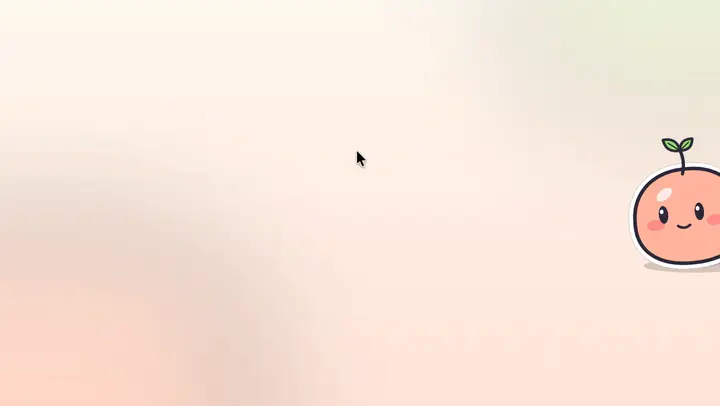
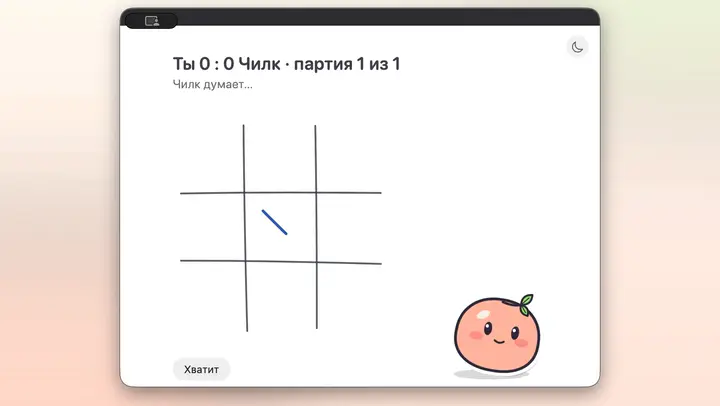
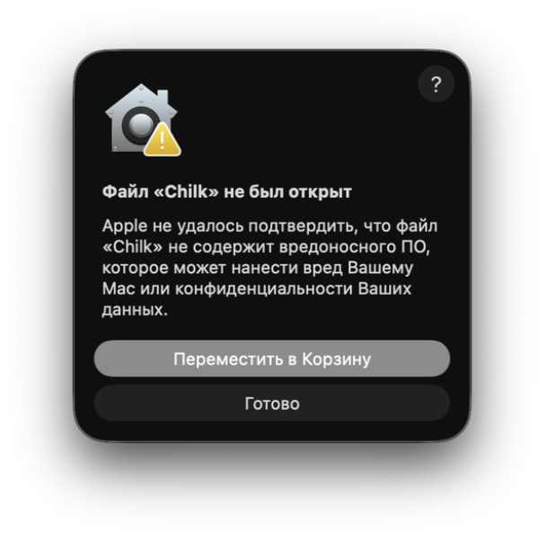
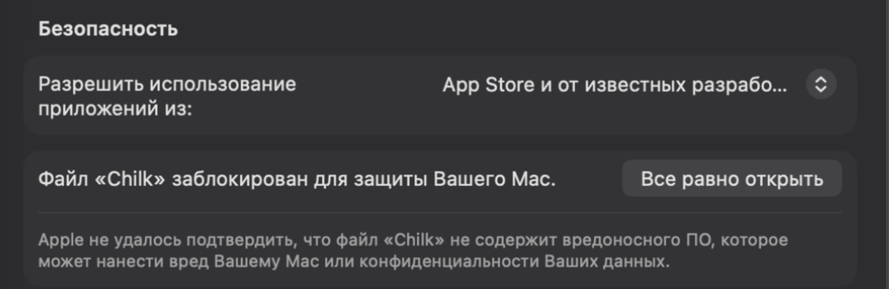

<p align="center">
  
</p>

<h1 align="center">Чилк</h1>

<p align="center">
  <b>Маленький живой компаньон у края экрана твоего Mac,<br>
  который следит, чтобы ты пил воду, разминался, гулял и вовремя заканчивал работу.</b>
</p>

<p align="center">
  <a href="https://github.com/all0b0y/Chilk/releases/latest"></a>
  
  
  <a href="../../LICENSE"></a>
</p>

<p align="center"><a href="../../README.md">English</a> · <b>Русский</b></p>

<!-- HERO_VIDEO_RU -->

## Зачем

Таймеры-напоминалки сначала игнорируют, а потом выключают. Чилк — не таймер, а персонаж. Он живёт у края экрана, дышит,
моргает и следит глазами за курсором. Когда ты засиделся, он начинает заботиться: сначала намёк, потом просьба, а в
строгом режиме он и правда прерывает работу. При этом он друг, а не надзиратель: его можно уговорить, у него всегда
есть экстренный выход, а созвоны для него неприкосновенны.

## Что он умеет

### Живой



- Дышит, моргает, следит за курсором и сам что-нибудь вытворяет: зевает, играет с листиком, ловит пылинку.
- Если по нему кликнуть — обижается, от трёх кликов у него кружится голова, а если погладить курсором — подмигивает.
- Его можно перетащить к любому краю и на любую высоту или задвинуть за край — он всё равно иногда выглядывает. Если
  мониторов несколько, он перепрыгивает на тот, где ты работаешь.
- Листик на голове показывает, насколько ты устал. Он смеётся над шутками, обижается, дурачится и танцует, когда
  играет музыка.

### Забота с настойчивостью


- Вода, разминка, отдых для глаз, прогулка, конец рабочего дня и отбой — не по жёсткому таймеру, а по накопившейся
  потребности и в удобный момент: когда ты переключаешь приложения или делаешь паузу в наборе текста. Созвоны, показ
  экрана и полноэкранные приложения он не трогает.
- Если его игнорировать, он настаивает сильнее: пантомима, облачко, просьба настойчивее, а в строгом режиме — пауза на
  весь экран. Из-за воды и глаз он никогда не блокирует. А если долго не делать вообще ничего, он ложится и просит о
  помощи.
- Всегда есть экстренный выход с причиной — их число ограничено, но выйти можно всегда. Чилка можно уговорить отложить
  отдых, объяснив, почему сейчас важно, и заранее объявить «Не беспокоить». Отложенный отдых копится долгом.
- Три режима: Строгий, Мягкий и Тишина. Смягчить режим посреди эскалации нельзя.
- Перерывы вместе с ним: дышать в такт (он надувается и сдувается), гимнастика для глаз за летающим Чилком, прогулка —
  он надевает шляпу, собирает рюкзак, уходит вместе с тобой и радуется твоему возвращению.

### Голос и приложения Apple


- Скажи «Чилк, …» или нажми <kbd>⌃⌥Space</kbd>: он вылетает из-за края и слушает, а ты видишь свои слова прямо по
  ходу речи.
- Его мозг — [Codex](https://github.com/openai/codex) под твоим аккаунтом ChatGPT. Он отвечает облачком (длинные ответы
  открываются в панели), ищет в интернете, находит нужное в папках, которые ты разрешил (только чтение), и записывает
  в приложения Apple: напоминания, события, заметки и таймеры в «Часах».
- Всё, что он записывает, ждёт твоего «Да» на карточке — и только в свой список, календарь и папку «Чилк».
- План дня можно составить за один разговор и подтвердить одной карточкой. Лист дня с галочками, утром сводка, вечером
  итоги, а несделанное переносится на завтра.
- Он помнит факты о тебе — каждый можно посмотреть, исправить и удалить.

### Игры



Крестики-нолики, баскетбол, морской бой и русские шашки — с Чилком, прямо на рабочем столе.

<sub>Ролики сняты на демо-профиле с тестовыми напоминаниями, событиями и заметками; ответы — настоящие ответы
Codex.</sub>

## Установка

1. Скачай **Chilk-0.1.0.dmg** из [последнего релиза](https://github.com/all0b0y/Chilk/releases/latest).
2. Открой его и перетащи Чилка в папку «Программы».
3. Запусти Чилка из «Программ». Чилк не нотаризован Apple (для этого нужен платный аккаунт разработчика Apple), поэтому
   первый запуск каждой скачанной версии macOS останавливает. Разреши его один раз:

   | | |
   |---|---|
   |  | macOS сообщает, что не может проверить Чилка. Нажми **Готово**. |
   |  | Открой **Системные настройки → Конфиденциальность и безопасность**, прокрути до раздела **Безопасность** и нажми **Все равно открыть** рядом с «Файл «Chilk» заблокирован для защиты Вашего Mac». |
   |  | Подтверди паролем или Touch ID и ещё раз нажми **Все равно открыть**. |

4. Чилк появится у края экрана, а его пульт — листик в строке меню (значка в Dock у него нет).
5. Дай ему мозг: поставь Codex — `brew install --cask codex` (или `npm install -g @openai/codex`), — затем нажми на
   листик в строке меню → **Войти в Codex** и войди своим аккаунтом ChatGPT.
6. Разреши то, чем пользуешься, когда он спросит впервые: микрофон и распознавание речи — для голоса, Напоминания,
   Календарь и Заметки — для этих приложений. Для таймеров в «Часах» он предложит добавить свою быструю команду «Чилк» —
   нажми **Добавить**. При первом включении ушей он один раз скачивает модель, по которой узнаёт своё имя (около
   1,5 ГБ).

SHA-256 образа лежит рядом с ним в релизе, в файле `SHA256SUMS.txt`.

## Требования

- macOS 26 или новее на Mac с Apple silicon.
- [Codex](https://github.com/openai/codex) и аккаунт ChatGPT с доступом к Codex. Чилк запускает его в собственном
  изолированном профиле, отдельно от твоего.
- Русский язык: Чилк говорит и слушает по-русски.
- Около 1,5 ГБ на диске для модели слуха — она скачивается при первом включении ушей.

## Приватность

- Всё, что ты делаешь, остаётся на твоём Mac: потребности, перерывы, план, переписка и факты, которые он помнит.
- Своё имя он слышит прямо на Mac (Whisper через Core ML), а твои слова распознаёт встроенная в macOS диктовка без
  интернета. Звук не сохраняется.
- То, о чём ты его просишь, уходит в OpenAI через Codex под твоим аккаунтом ChatGPT. Codex работает в собственном
  профиле Чилка: без доступа к командной строке и только с теми папками, которые ты выбрал.
- В Напоминаниях, Календаре и Заметках он трогает только свои список, календарь и папку «Чилк» и записывает только после
  твоего «Да».
- Никакой аналитики и телеметрии. В сеть ходят только Codex и разовые загрузки моделей.

## Как это устроено

```
┌──────────────────────── Chilk.app ────────────────────────┐
│  ChilkCore    тело, потребности, лестница эскалации, план │
│  ChilkRender  персонаж на Core Animation                  │
│  ChilkEars    микрофон → голос (libfvad) → его имя        │
│               (WhisperKit) → диктовка Apple, ru-RU        │
│  ChilkBrain   клиент Codex app-server (JSON-RPC, stdio) ──┼──► codex ──► OpenAI (твой аккаунт)
│  ChilkApple   Напоминания · Календарь · Заметки · Часы    │
└───────────────────────────────────────────────────────────┘
```

| Часть | На чём |
|---|---|
| Приложение | Swift 6, SwiftUI и AppKit; живёт в строке меню |
| Персонаж | Core Graphics и Core Animation |
| Слух | AVAudioEngine, libfvad, WhisperKit (Core ML), Speech |
| Мозг | Codex app-server в отдельном `CODEX_HOME` |
| Приложения Apple | EventKit, AppleScript для Заметок, быстрая команда для «Часов» |

## Сборка из исходников

Всё описано в [CONTRIBUTING.md](../../CONTRIBUTING.md) (на английском): Xcode 26 и XcodeGen, один скрипт собирает и
запускает, другой делает DMG.

## Состояние проекта

Альфа, версия 0.1.0 — между версиями многое может меняться. Впереди: английская версия, шахматы, планировщик на неделю
с повторяющимися делами и блоками времени, звуки и выбор цвета Чилка.

## Лицензия

[Apache License 2.0](../../LICENSE). Чилка можно использовать, менять и строить на нём свои продукты, в том числе
платные, — если сохранить файл [NOTICE](../../NOTICE) с именем автора (**all0b0y**) в уведомлениях своего продукта или в
окне «О программе», как требует раздел 4 лицензии. Название «Chilk» / «Чилк» для своего продукта брать нельзя
(раздел 6). Сторонние компоненты — в [THIRD_PARTY_NOTICES.md](../../THIRD_PARTY_NOTICES.md).
